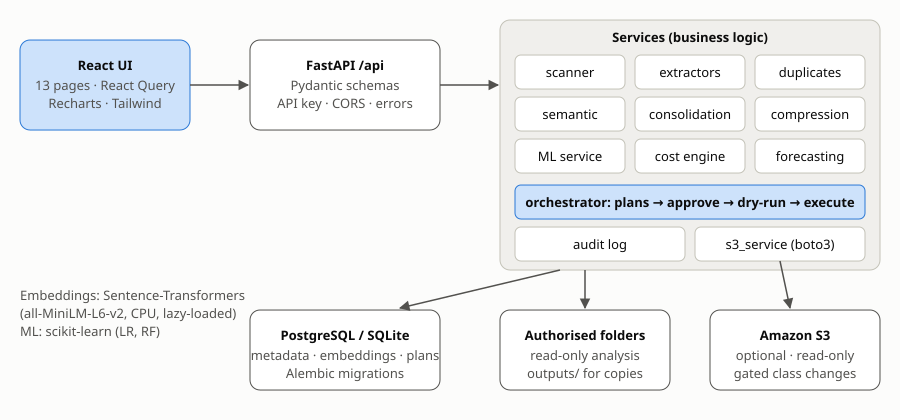

# Architecture

OptiStore AI is a **modular monolith**: one FastAPI process, one database, and a React single-page app. The modules are separated by responsibility, so any of them could later be extracted, but the MVP has no message broker, cache or microservices.



## Layers

| Layer | Location | Responsibility |
| --- | --- | --- |
| API | `backend/app/api/routes/*.py` | HTTP concerns only: validation through Pydantic schemas, status codes, pagination. Calls services. |
| Schemas | `backend/app/schemas/api.py` | Request/response contracts (also drive the OpenAPI docs at `/docs`). |
| Services | `backend/app/services/*.py` | Business logic. No HTTP types. Each module owns one capability. |
| ML | `backend/app/ml/` | Pure ML code (synthetic data, features, training, evaluation, persistence), independent of the database. |
| Persistence | `backend/app/db/` | SQLAlchemy 2.0 models, session factory, Alembic runner. |
| Core | `backend/app/core/` | Settings (pydantic-settings), safe path handling, time helpers. |

## Main flows

### Scan (`POST /api/scans`)

1. The API re-validates that the location is inside `ALLOWED_SCAN_ROOTS`, creates a `ScanJob`, and returns `202` immediately.
2. `scanner.run_scan` runs as a background task with its own DB session:
   - lists files with `os.walk(followlinks=False)` (symlinks are skipped, tooling folders are ignored),
   - per file: size limit → SHA-256 (streamed) → magic-number check → type-specific extraction,
   - upserts `FileRecord` rows, increments progress, and checks `cancel_requested` every 10 files,
   - marks files that disappeared as `missing` (history is kept),
   - indexes documents (chunks + embeddings, skipped when the content hash is unchanged),
   - recomputes exact duplicate groups and similarity pairs, and stores a `StorageSnapshot`.
3. The UI polls `GET /api/scans/{id}` for progress.

S3 locations use the same pipeline. `s3_service.list_objects` and `analyze_object` replace the local listing and reading, and objects are downloaded only up to `S3_MAX_DOWNLOAD_MB` and never from archive classes.

### Semantic layer (`services/semantic.py`, `services/embeddings.py`)

- Text is normalised and split into ~900-character chunks with 150-character overlap at paragraph/sentence boundaries. The file name is prepended to each chunk for context.
- Embeddings are L2-normalised float32 vectors stored in `document_chunks.embedding`, together with the model id, so changing the model triggers a re-index.
- **Document similarity** is the cosine of mean chunk vectors. **Coverage** is the share of a document's chunks whose best match in the other document is ≥ `chunk_match_threshold`.
- **Comparison** aligns sentences across both documents and reports shared/unique statements. Conflicts come from deterministic rules (`services/facts.py`): same normalised key with a different value, or related sentences with differing figures or dates.
- **Vector index** (`services/vector_index.py`): FAISS `IndexFlatIP` (exact cosine on normalised vectors) when installed, otherwise identical NumPy search. Document similarity uses 50 nearest neighbours per document instead of all pairs.
- **Search** is hybrid: `0.55·semantic + 0.20·TF-IDF + 0.25·file-name match`, best chunk per file. The index and TF-IDF matrix are cached in memory and rebuilt when chunks change.
- **OCR** (`extractors.ocr_pdf`, `extractors.image_text`): PDFs without a text layer are rendered with pdfium at about 300 dpi and read with Tesseract; images with at least 20 recognised letters become searchable.
- **Video** (`services/video.py`): ffprobe metadata for every container. The compression benchmark re-encodes to H.265 into a temporary file, measures size and PSNR, then deletes it; approved plan actions write the copy to `outputs/`. Only fixed argument lists are passed to the binaries (no shell).

### Plans (`services/orchestrator.py`)

`build_plan` runs every analysis for the scope and turns the results into `PlanAction` rows of five fixed types:

| Type | Executable | Effect |
| --- | --- | --- |
| `review_duplicate_group` | no (manual) | Approval records the review; files are never deleted |
| `create_consolidation_draft` | yes | Creates a draft record; sources untouched |
| `create_compressed_copy` | yes | Writes a compressed copy to `data/outputs/compression/` |
| `s3_change_storage_class` | yes | In-place copy with a new `StorageClass` (requires `S3_WRITE_ENABLED`) |
| `storage_class_simulation` | no (info) | Summary for local files |

Actions are sorted by expected monthly saving, then by risk. Execution requires `status == approved`. Lossy and cloud actions also require `acknowledge_risks=true` at approval time. Every decision, dry run, success and failure is written to `operation_logs`.

## Data model

```
storage_locations 1─* scan_jobs
storage_locations 1─* files *─1 duplicate_groups
files 1─* document_chunks           (text + embedding per chunk)
files 1─* compression_results
files 1─* access_events             (source: imported_log | synthetic_demo)
files 1─* access_predictions *─1 model_evaluations
files 1─* storage_recommendations   (per strategy)
similarity_pairs (file_a, file_b, score, coverage)
consolidations   (sources, draft, edited text, report, sizes, export)
optimization_plans 1─* plan_actions
storage_snapshots, operation_logs, app_settings
```

Migrations live in `backend/alembic/versions`. The app runs `alembic upgrade head` on start-up, and `alembic check` verifies that the models and migrations agree.

## Design decisions

- **SQLite by default, PostgreSQL in Compose.** One codebase (portable SQLAlchemy types such as `JSON` and `LargeBinary`); SQLite keeps local setup to a single `pip install`.
- **Embeddings in the relational DB.** This keeps the MVP self-contained and transactional. Brute-force NumPy search is adequate for tens of thousands of chunks; FAISS or pgvector is the planned next step.
- **Deterministic consolidation.** It is reproducible, auditable, works offline and cannot hallucinate. The trade-off is that it merges and lists content rather than rewriting prose.
- **Lexical fallback embedder.** Tests run fast and deterministically, and the app keeps working offline. The UI always shows which backend is active.
- **Background tasks instead of a job queue.** Adequate for a single-user tool. A crash mid-scan leaves the job in `running`; a queue such as RQ, Celery or Arq is on the roadmap.
